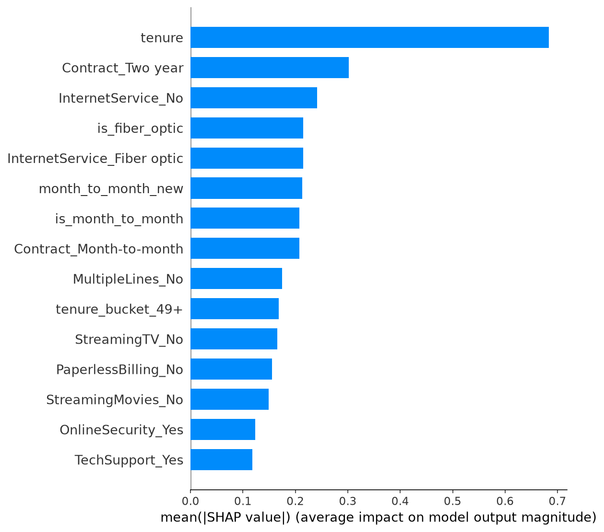
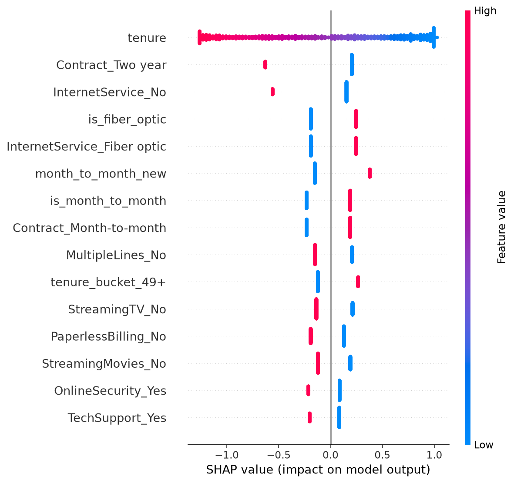

# Customer Churn Prediction with Explainability

[](https://github.com/kaur-nel/churn-prediction/actions/workflows/ci.yml)

Predicts which telecom customers are likely to leave, explains each prediction with SHAP,
and estimates the money saved by sending retention offers to the right customers.

The money figures use configurable assumptions (customer value, offer cost, offer success rate), not real company data. See [Business impact](#business-impact).

## Results at a glance

**Winner: logistic regression.** It was statistically tied with random forest and XGBoost in cross-validation, so the simplest and most explainable model was chosen. The test split (1,409 customers, 26.5% churn) was evaluated once, on 2026-11-08, and the results are frozen.

| Metric | Result (95% bootstrap CI) |
|---|---|
| PR-AUC | 0.652 (0.599 to 0.702); random guessing gives about 0.265 |
| ROC-AUC | 0.845 (0.823 to 0.866) |
| Recall (churners caught) | 0.896 (0.862 to 0.926) |
| Precision (flagged customers who really churn) | 0.460 (0.423 to 0.497) |
| Customers flagged | 51.7% (49.0 to 54.5) |
| Brier score / calibration error | 0.136 / 0.015 |

Confusion matrix at the chosen threshold (0.171): 642 true negatives, 393 false positives, 39 false negatives, 335 true positives.

**What this means.** The model ranks churners well above chance and catches about 9 in 10 of them. It does this by flagging about half of all customers, so more than half of the flagged customers would not have left. That is deliberate: the threshold was chosen on the validation split to maximise estimated net benefit, because the assumed offer cost (50) is small next to the assumed value of a lost customer (1,000).

## Business impact

Using the assumptions in `configs/config.yaml` (customer value 1,000, offer cost 50, offer success rate 30%), targeting customers above the chosen threshold gives an estimated net benefit of about **45,493 per 1,000 customers** (CI 38,963 to 51,385), against about 29,631 if every customer got an offer and 0 for no campaign. Real values would change the threshold and the savings; `reports/sensitivity_table.csv` shows the result across 27 combinations of value, cost and success rate.

<p>
  
  
</p>

## What drives churn

**In the data** (7,043 customers; associations, not proven causes):

1. **Contract type** is the strongest signal: month-to-month customers churn 42.7%, one-year 11.3%, two-year 2.8% (overall 26.5%).
2. **New customers leave most:** 52.9% churn in the first 6 months, falling to 9.5% after 49 months.
3. **Fiber optic churns about twice as often as DSL:** 41.9% vs 19.0%. Customers with no internet service churn 7.4%.
4. **Payment method:** electronic-check payers churn 45.3%, against 15 to 17% for automatic payment.
5. **Support add-ons go with lower churn.** Among customers with internet service, those without tech support churn 41.6% and those with it 15.2%. Churn falls from 52.2% with no add-ons to 5.3% with all six.

**In the model.** SHAP values are summed per group of related columns (for example, `Contract` combines its one-hot columns). On the validation split the biggest drivers are contract type (17.2% of total importance), internet service (16.6%), tenure (14.0%), the month-to-month-new flag (6.1%) and multiple lines (5.7%). SHAP waterfall plots for three sample customers are in `reports/figures/`.

<p>
  
  
</p>

## Fairness

Checked on the test split for `gender` and `SeniorCitizen` (`gender` is not a model feature; `SeniorCitizen` is).

- **Gender:** gaps are small (recall 0.886 for female vs 0.906 for male).
- **SeniorCitizen: a real gap.** The model flags 78.4% of senior customers vs 46.7% of others, and wrongly flags 63.7% of seniors who did not churn vs 34.5% of others. Seniors do churn more (44.1% vs 23.3%), so part of the gap reflects real differences. Seniors' recall is higher (0.969 vs 0.870) and so is their precision (0.546 vs 0.433), but their ROC-AUC is lower (0.780 vs 0.847), so the model ranks them less reliably.

The generated report flags the false-positive-rate and flagged-share gaps (both above 0.10). The recall gap (0.0998) is just under the limit.

**Decision:** the model was kept unchanged and the gap is documented here. Fixing it (dropping the feature or using group-specific thresholds) would mean building a new model version and evaluating it on fresh data, because the test split has already been used.

## How it works

```
raw CSV -> clean -> stratified split 60/20/20 -> features -> model comparison and tuning
        -> final model (logistic regression, calibration checked on validation)
        -> business threshold (validation) -> one-time test evaluation
        -> SHAP, prediction CLI, drift check, model card and report
```

- Only fixed-rule cleaning happens before the split. Imputing, scaling, encoding and calibration are fitted on the training split only, inside an sklearn pipeline, to prevent leakage.
- Cleaning: 11 blank `TotalCharges` values (customers with zero tenure) were set to 0, which is an assumption. 9,838 cells saying "No internet service" or "No phone service" were changed to "No". No duplicate rows were found.
- Engineered features: tenure buckets, charges ratio, add-on count, and contract-risk flags (`is_month_to_month`, `month_to_month_new`, and others). `TotalCharges` is left out of the logistic regression because a variance-inflation check showed it is nearly redundant with tenure and monthly charges.
- Model comparison (stratified 5-fold CV on train, PR-AUC): random forest 0.665, logistic regression 0.665, XGBoost 0.657, LightGBM 0.632. The first three are within noise of each other, so logistic regression was chosen for simplicity.
- Optuna tuning (30 trials) and SMOTE (applied inside the CV pipeline only) gave no gain beyond the cross-validation noise and were not adopted. Calibration (none, sigmoid, isotonic) did not beat the uncalibrated model, so `none` was kept.
- Experiments are tracked with MLflow. All settings live in `configs/config.yaml`.

Generated documents: [`docs/model_card.md`](docs/model_card.md) and [`docs/report.md`](docs/report.md).

## Project layout

```
configs/config.yaml     all settings
src/                    pipeline modules, run as python -m src.<name>
tests/                  22 pytest files, including failure paths
reports/                result files (json/csv) and figures
docs/                   generated model card and report
models/                 the trained model (final_model.joblib, 13 KB)
examples/               a small made-up CSV for trying the prediction CLI
notebooks/01_eda.ipynb  exploratory analysis
Dockerfile, .github/    container and CI
```

## Setup

Requires Python 3.12. Commands are for Windows PowerShell, run from the repository root.

```powershell
python -m venv .venv
.venv\Scripts\Activate.ps1
pip install -r requirements-dev.txt
```

`requirements.txt` pins the direct dependencies. `requirements.lock.txt` pins every dependency, resolved for Linux and Python 3.12, and is what the Docker image installs.

## Usage

The trained model is committed, so scoring works right after cloning:

```powershell
python -m src.predict --input examples\sample_customers.csv --output predictions.csv
```

Other commands:

```powershell
python -m src.drift --input new_customers.csv   # feature drift (PSI)
python -m src.report        # regenerate docs/model_card.md and docs/report.md from reports/
python -m src.health        # configuration, imports and writable folders check
python -m pytest -q         # tests
ruff check .                # lint
```

`src.predict` takes the raw Telco format. It ignores `gender` and `Churn` and warns about unknown extra columns (`--strict` fails instead). `--threshold` overrides the saved threshold. It returns, for each customer, a churn probability and an offer flag.

## Reproducing the training run

**Data:** the dataset is not included. Download *Telco Customer Churn* from Kaggle (`WA_Fn-UseC_-Telco-Customer-Churn.csv`) and save it as `data/raw/telco_churn.csv`. Check the dataset's terms on Kaggle before reusing it.

`python -m src.train --force` rebuilds the model: it cleans the data, splits it, fits the final model and chooses the threshold on validation data. It does not touch the test split. `--force` is needed because `reports/test_results.json` is committed, and the command refuses to replace a model that has already been evaluated, so the reported test result cannot be silently replaced. On a fresh clone (Windows, Python 3.12), retraining produced a model file with the same SHA-256 as the one recorded in `reports/test_results.json`.

To repeat the whole study step by step, the generated report lists the order: `src.data`, `src.split`, `src.final_model`, `src.business`, `src.evaluate`, `src.explain`, `src.report`. `src.evaluate` refuses to run a second time unless `--rerun` is given.

## Testing and CI

GitHub Actions runs two jobs on every push and pull request:

- **Lint and tests:** ruff and pytest on Python 3.12.
- **Docker:** builds the image, runs the health check, and scores `examples/sample_customers.csv` inside the container using the committed model.

## Docker

The `Dockerfile` uses `python:3.12.10-slim-bookworm`, installs the full lockfile and the OpenMP library that LightGBM and XGBoost need, runs as a non-root user, and copies only `configs/` and `src/`. No data, model or reports go into the image; they are mounted when needed. The default command is `python -m src.train`, and the health check is `python -m src.health`.

```powershell
docker build -t churn-prediction .
docker run --rm churn-prediction python -m src.health
```

CI verifies the build, the health check and scoring inside the container. Training inside the container needs the Kaggle CSV mounted at `data/raw/` and has not been run there.

## Limitations

- **Single public dataset.** 7,043 customers from one source with unverified provenance and no time information, so performance on another company's customers is unknown. The test split holds 374 churners, which is why the confidence intervals are wide.
- **Predicts risk, not offer response.** The model ranks who is likely to leave, not who an offer would keep. The savings figures depend on the assumed customer value, offer cost and success rate.
- **Fairness.** Senior customers are flagged more often and have more false positives (see [Fairness](#fairness)). Only `gender` and `SeniorCitizen` were checked.

## Next steps

- Run a randomized offer test and try uplift modelling to measure the real effect of an offer.
- Build a new model version that addresses the SeniorCitizen gap and evaluate it on fresh data.