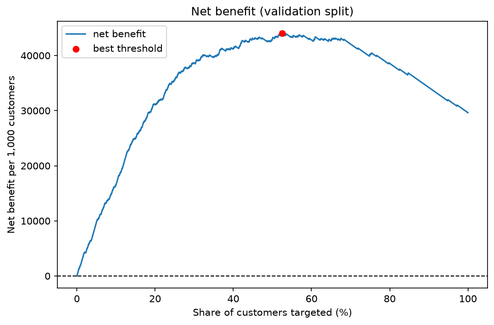
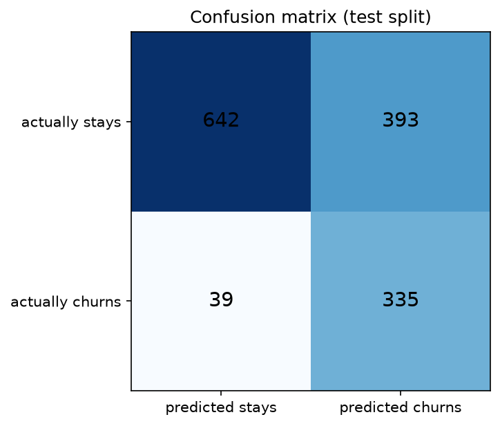

# Customer Churn Prediction with Explainability

[](https://github.com/kaur-nel/churn-prediction/actions/workflows/ci.yml)

Predicts which telecom customers are likely to leave, explains each prediction with SHAP,
and estimates the money saved by sending retention offers to the right customers.

This is a portfolio project. The money figures rest on **placeholder assumptions, not real company data** (see [Limitations](#limitations)).

## Results at a glance

The test split (1,409 customers, 26.5% churn) was evaluated once, on 2026-11-08, and the results are frozen.

| Metric | Result (95% bootstrap CI) |
|---|---|
| PR-AUC | 0.652 (0.599 to 0.702); random guessing gives about 0.265 |
| ROC-AUC | 0.845 (0.823 to 0.866) |
| Recall (churners caught) | 0.896 (0.862 to 0.926) |
| Precision (flagged customers who really churn) | 0.460 (0.423 to 0.497) |
| Customers flagged | 51.7% (49.0 to 54.5) |
| Brier score / calibration error | 0.136 / 0.015 |

Confusion matrix at the chosen threshold (0.171): 642 true negatives, 393 false positives, 39 false negatives, 335 true positives.

**What this means.** The model ranks churners well above chance and catches about 9 in 10 of them. It does this by flagging about half of all customers, so more than half of the flagged customers would not have left. That is deliberate. The threshold was chosen on the validation split to maximise estimated net benefit, because the assumed offer cost (50) is small next to the assumed value of a lost customer (1,000).

**Estimated net benefit** (placeholder money assumptions): about 45,493 per 1,000 customers (CI 38,963 to 51,385), against about 29,631 if every customer got an offer.

<p>
  
  
</p>

## Explainability

SHAP values are summed per group of related columns (for example, `Contract` combines its one-hot columns). On the validation split the biggest drivers are contract type (17.2% of total importance), internet service (16.6%), tenure (14.0%), the month-to-month-new flag (6.1%) and multiple lines (5.7%).

<p>
  
  
</p>

Patterns in the full dataset (7,043 customers): month-to-month contracts churn 42.7% vs 2.8% for two-year contracts; fiber optic 41.9% vs DSL 19.0%; electronic-check payers 45.3% vs 15 to 17% for automatic payment; customers in their first 6 months 52.9% vs 9.5% after 49 months. These are associations, not proven causes.

## Fairness

Checked on the test split for `gender` and `SeniorCitizen` (`gender` is not a model feature; `SeniorCitizen` is).

- **Gender:** gaps are small (recall 0.886 for female vs 0.906 for male).
- **SeniorCitizen: a real gap.** The model flags 78.4% of senior customers vs 46.7% of others, and wrongly flags 63.7% of seniors who did not churn vs 34.5% of others. Seniors do churn more (44.1% vs 23.3%), so part of the gap reflects real differences. Seniors' recall is higher (0.969 vs 0.870) and so is their precision (0.546 vs 0.433), but their ROC-AUC is lower (0.780 vs 0.847), so the model ranks them less reliably.

The generated report flags the false-positive-rate and flagged-share gaps (both above 0.10). The recall gap (0.0998) is just under the limit.

**Decision:** the model was kept unchanged and the gap is documented here. Fixing it (dropping the feature or using group-specific thresholds) would mean building a new model version and evaluating it on fresh data, because the test split has already been used.

## How it works

```
raw CSV -> clean -> stratified split 60/20/20 -> features -> model comparison and tuning
        -> final model (logistic regression, calibration checked on validation)
        -> business threshold (validation) -> one-time test evaluation
        -> SHAP, prediction CLI, drift check, model card and report
```

- Only fixed-rule cleaning happens before the split. Imputing, scaling, encoding and calibration are fitted on the training split only.
- Cleaning: 11 blank `TotalCharges` values (customers with zero tenure) were set to 0, which is an assumption. 9,838 cells saying "No internet service" or "No phone service" were changed to "No". No duplicate rows were found.
- Model comparison (5-fold CV on train, PR-AUC): random forest 0.665, logistic regression 0.665, XGBoost 0.657, LightGBM 0.632. The first three are within noise of each other, so logistic regression was chosen for simplicity.
- Optuna tuning (30 trials) and SMOTE gave no gain beyond the cross-validation noise and were not adopted. Calibration (none, sigmoid, isotonic) did not beat the uncalibrated model, so `none` was kept.
- All settings live in `configs/config.yaml`.

Generated documents: [`docs/model_card.md`](docs/model_card.md) and [`docs/report.md`](docs/report.md).

## Project layout

```
configs/config.yaml     all settings
src/                    pipeline modules, run as python -m src.<name>
tests/                  22 pytest files, including failure paths
reports/                result files (json/csv) and figures
docs/                   generated model card and report
notebooks/01_eda.ipynb  exploratory analysis
Dockerfile, .github/    container and CI
```

## Setup

Requires Python 3.12. Commands are for Windows PowerShell, run from the repository root.

```powershell
python -m venv .venv
.venv\Scripts\Activate.ps1
pip install -r requirements-dev.txt
```

**Data:** the dataset is not included in this repository. Download *Telco Customer Churn* from Kaggle (`WA_Fn-UseC_-Telco-Customer-Churn.csv`) and save it as `data/raw/telco_churn.csv`. Check the dataset's terms on Kaggle before reusing it.

**Note:** `requirements.txt` pins the direct dependencies (used for local setup). `requirements.lock.txt` pins every dependency, resolved for Linux and Python 3.12, and is what the Docker image installs.

## Usage

```powershell
python -m src.predict --input customers.csv --output predictions.csv   # score raw customer rows
python -m src.drift --input new_customers.csv                          # feature drift (PSI)
python -m src.report        # regenerate docs/model_card.md and docs/report.md from reports/
python -m src.health        # configuration, imports and writable folders check
python -m pytest -q         # tests
ruff check .                # lint
```

`src.predict` takes the raw Telco format. It ignores `gender` and `Churn` and warns about unknown extra columns (`--strict` fails instead). `--threshold` overrides the saved threshold. Scoring needs the trained model file `models/final_model.joblib`, which is not committed to the repository.

## Reproducing the training run

`python -m src.train` cleans the data, splits it, fits the final model and chooses the threshold on validation data. It does not touch the test split.

It has a lock. If `reports/test_results.json` exists, it refuses to run, so the reported test result cannot be silently replaced. That file is committed to this repository, so on a fresh clone the command stops with an error, by design (read from the code; not run on a fresh clone). Retraining there needs `--force`, which overwrites the saved results and is untested.

To repeat the whole study step by step, the generated report lists the order: `src.data`, `src.split`, `src.final_model`, `src.business`, `src.evaluate`, `src.explain`, `src.report`. `src.evaluate` refuses to run a second time unless `--rerun` is given.

## Testing and CI

GitHub Actions runs two jobs on every push and pull request: lint and tests (ruff and pytest on Python 3.12), and a Docker build followed by `python -m src.health` inside the image.

## Docker

The `Dockerfile` uses `python:3.12.10-slim-bookworm`, installs the OpenMP library that LightGBM and XGBoost need, runs as a non-root user, and copies only `configs/` and `src/`. No data, model or reports go into the image. The default command is `python -m src.train`, and the health check is `python -m src.health`.

```powershell
docker build -t churn-prediction .
docker run --rm churn-prediction python -m src.health
```

The image builds and passes the health check in GitHub Actions. I could not build it on my own Windows machine: `pip install` inside Docker kept timing out, and I did not find the cause. So **training and prediction inside the container have not been verified.**

## Limitations

- **Money figures are placeholders.** Customer value (1,000), offer cost (50) and offer success rate (30%) are invented for illustration. Real numbers would change the threshold and the savings. The sensitivity table is in `reports/sensitivity_table.csv`.
- **No causal evidence.** The model predicts who is likely to leave, not who an offer would keep. Uplift modelling and a randomized offer test are the right next step.
- **One public dataset.** 7,043 customers from a single source with unverified provenance and no time information. Performance on another company's customers is unknown.
- **Low precision by design:** more than half of flagged customers would not have churned.
- **Wide intervals:** the test split holds 374 churners.
- **Fairness:** the SeniorCitizen gap above is unresolved, and only `gender` and `SeniorCitizen` were checked.
- **Docker** was verified only in CI.

## Next steps

- Measure the real offer effect with a randomized test; consider uplift modelling.
- Address the SeniorCitizen gap with a new model version evaluated on fresh data.
- Pin all dependencies across platforms.